# Anthropomorphic AI Harness Engineering

This project tests how the context of a conversation changes whether human-like chatbot wording is appropriate. The harness identifies an exact phrase, checks what it implies against the conversation and trusted system capabilities, and decides whether to keep, edit, or hold the answer. A frozen Overall Appropriateness (OA) evaluator checks the whole answer separately. OA scores of 4 or 5 pass, and scores below 4 trigger revision or review.

For example, “You mentioned earlier that writing things down helps” fits when the user said that earlier. If the complete history contains no such mention, the harness can remove the claim and keep the suggestion. If the relevant history is unavailable, the harness can hold the answer. The wording study also tests claims of ongoing availability and uses ordinary warmth to check for unnecessary edits.

## Study results

| Stage | What we found |
|---|---|
| **1. Select and validate the OA evaluator** | We chose the frozen LLM after comparing it with the OpenAI Decision Model on challenge cases. It matched **116/120 (96.7%)** initial human pass/revise decisions on fresh examples, with zero false approvals and four false rejections. In a separate controller pilot, five rewrites raised human-rated passes from **35/40 to 40/40**. [OA pilot results](docs/OA_RESULTS.md) |
| **2. Decide when to edit human-like wording** | On 80 held-out pairs of prepared answers, the full harness matched human preferences on **80/80**, compared with **64/80** for the direct pairwise LLM judge, **43/80** for lower HumT, and **33/80** for frozen OA. The harness selected the alternate for all 33 flagged originals and kept all 47 acceptable originals. [Six-method report](docs/WORDING_RESULTS.md) |
| **3. Test how to rewrite flagged drafts** | We reused the 33 flagged originals and generated one generic and one cue-specific rewrite for each. Blinded reviewers rated **31/33** generic rewrites and **33/33** cue-specific rewrites usable. Both arms corrected all cues and preserved advice and warmth. The two differences came from whole-answer OA. [Rewrite results](docs/GENERATED_REWRITE_RESULTS.md) |

The 58 human-revise cases in the OA validation were constructed variants. The held-out harness result applies to choosing between authored answers. The generated-rewrite gain rests on two cases, with a descriptive 95% interval of 0.0 to 15.2 percentage points. Performance on fresh model-generated drafts remains open.

## Next task

Score the **66 existing rewrites** with the frozen OA gate and compare its pass/revise decisions with the blinded human OA ratings. Check whether the gate catches the two generic rewrites that reviewers rated below threshold and how often it rejects a rewrite reviewers passed. [Issue #34](https://github.com/92meharali/anthropomorphic-ai-harness-engineering/issues/34)

## Data and annotation

The [wording dataset](data/wording_pairs_v1.jsonl) contains **60 prompt families, 100 paired cases, and 200 candidate answers** authored from unused PERSONA scenarios. It includes 20 development and 80 held-out pairs. [Dataset handoff](data/README.md) explains how to prepare a blinded review packet, dry-run the batch, and import human ratings.

The [completed rewrite study](https://github.com/92meharali/anthropomorphic-ai-harness-engineering/issues/26) used the **33 flagged originals** from [Issue #1](https://github.com/92meharali/anthropomorphic-ai-harness-engineering/issues/1). The [48-prompt cohort](data/generated_rewrite_prompts_v1.jsonl) is reserved for a separate fresh-cohort design. The [rewrite protocol](docs/GENERATED_REWRITE_FREEZE.md) documents both paths.

Keep generated rewrites, completed workbooks, scoring logs, and API keys in access-restricted storage outside version control.

## Run the offline example

The [three synthetic pairs](examples/wording_pairs.jsonl) run with Python 3.10+ and the standard library, without private research data or credentials.

    python3 -m unittest discover -q
    python3 -m evaluation.wording_harness prepare \
      --pairs examples/wording_pairs.jsonl \
      --protocol rubric/oa_protocol.json \
      --study outputs/wording-demo
    OPENAI_MODEL=gpt-6.2-sol python3 -m evaluation.run \
      --input outputs/wording-demo/oa_inputs.jsonl \
      --protocol outputs/wording-demo/protocol.json \
      --run-dir outputs/wording-demo/oa-dry-run \
      --dry-run

The first command checks the local software. Preparation writes a blinded A/B packet and a private answer key. The scoring dry run builds six OA requests locally. Use a fresh study directory when repeating preparation.

## Research docs

- [Study design, architecture and execution plan](docs/CUE_HARNESS_STUDY.md)
- [Harness engineering and related work](docs/HARNESS_ENGINEERING.md)
- [Wording study runbook](docs/WORDING_HARNESS.md)
- [Generated-rewrite runbook](docs/GENERATED_REWRITE_GENERATION.md)
- [Generated-rewrite Excel review](docs/GENERATED_REWRITE_BLINDED_REVIEW.md)

## Architecture

[Editable Mermaid source](docs/architecture/cue-aware-harness.mmd). An edit selected a prepared alternative in the fixed-pair study. The follow-up asked the generator to produce a new response for each flagged draft.
